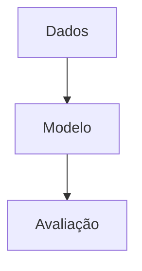

# O Markdown da conversa

O que o app desenha no texto das respostas, dos enunciados, das alternativas e das explicações (o componente Markdown de packages/ui/src/visual/Markdown.tsx). Serve para quem escreve prompt e skill saber o que pode pedir ao modelo. As notas do caderno têm outro formato, em notas-formato.md.

Os rótulos curtos (enunciado e alternativas de questão, título de pedido) usam o mesmo Markdown sem parágrafos, para caber numa linha: ali o que mais importa é o código em linha. Blocos, se aparecerem, continuam sendo desenhados.

HTML cru no texto não é interpretado: aparece como texto.


## Markdown comum (GFM)

- Títulos, parágrafos, **negrito**, *itálico*, ~~riscado~~, citação com `>` e linha divisória com `---`.
- Listas com `-` ou `1.`, e listas de tarefa com `- [ ]` e `- [x]`.
- Tabelas com `|`.
- Links `[texto](https://...)`. Abrem fora do app.
- Ligações próprias de um perfil: `Markdown` aceita `ligacoes?: Record<string, (alvo: string, filhos: ReactNode) => ReactNode>`, pelo esquema do link (`api:metodo`, por exemplo). `ProvedorLigacoesMarkdown` compartilha o registro com Markdowns aninhados; uma prop `ligacoes` local substitui o registro herdado (`{}` o desliga). O callback recebe só o alvo, sem o esquema. Esquemas sem função viram texto; registrar um esquema não o libera no `src` de imagens. O núcleo não interpreta o significado da ligação.


## Matemática (LaTeX)

`$...$` no meio da frase e `$$...$$` num bloco, desenhados pelo KaTeX. Uma fórmula com erro aparece em vermelho, sem derrubar o resto do texto.

```
A derivada de $x^2$ é $2x$.

$$\int_0^1 x^2\,dx = \frac{1}{3}$$
```

O $ de dinheiro não abre fórmula, para "R$ 20 … R$ 19" não virar LaTeX entre os dois $. Fica como texto comum:

- o $ logo depois de uma letra: `R$ 20`, `US$ 0,03`, `A$`, `C$`, e também `R$20`;
- o $ seguido de espaço: `$ 5`, `custa $ 20`. Como no pandoc, um $ de abertura seguido de espaço não abre fórmula: `$ x $` fica como texto.

A fórmula na linha, então, começa com o $ colado no primeiro caractere da conta e sem letra logo antes dele: `$x^2$`, `$\frac{a}{b}$`, `a área é $\pi r^2$`, `$R$` (a variável R). Fórmula e preço convivem na mesma frase: `o lucro $L = R - C$ foi de R$ 300`. Dentro de código (em linha ou em bloco, vetor e matriz incluídos) o $ nunca é fórmula, e o `$$` em bloco não muda. Quem precisar de um $ literal num caso fora dessas regras escreve `\$`.


## Imagem da pasta de dados

O embed do Obsidian mostra uma imagem da pasta de dados do perfil: `![[nome.png]]`, `![[nome.png|650]]` (largura) ou `![[nome.png|650x300]]` (largura e altura). Vale para png, jpg, jpeg, webp e svg. O caminho é relativo à pasta de dados, ou só o nome (procurado nas pastas de imagens do profile.json). Imagem comum do markdown, ``, também funciona.


## Diagrama (mermaid)

Um bloco com a linguagem `mermaid` é desenhado como diagrama, no tema do app (visual/DiagramaMermaid.tsx; o mermaid carrega só quando aparece o primeiro bloco):

````

````

Enquanto o desenho não está pronto, o bloco aparece como código. Com a resposta ainda chegando, só se desenha depois de 0,4 s sem mudança no bloco, e o desenho anterior continua na tela até o novo ficar pronto. Se o mermaid recusar a sintaxe, o bloco continua como código (sem mensagem de erro). Em linha (rótulos de opção) o bloco não vira diagrama. O texto do diagrama é SVG puro, sem HTML, e o mermaid roda no modo estrito (sem script nem link).


## Código

Código em linha, entre crases (`` `len(x)` ``), aparece em letra mono, com fundo e cor próprios, sem quebrar a frase.

O bloco com três crases aparece numa caixa escura de editor, com os números de linha à esquerda (não vão junto ao copiar) e rolagem horizontal se a linha for longa. Com o nome da linguagem depois das crases, o bloco ganha cores de sintaxe e uma barra no topo com o nome:

````
```python
def media(notas):
    return sum(notas) / len(notas)  # média simples
```
````

Linguagens com cores: `python`, `javascript`, `typescript`, `sql`, `bash`, `json`, `r`, `java`, `c`, `cpp` e `plaintext`, e os apelidos delas (`py`, `js`, `ts`, `sh`, `zsh`, `c++`, `text`, entre outros). Sem linguagem, o bloco tem a mesma caixa, sem cores e sem barra. Com uma linguagem fora da lista, tem a barra com o nome, mas sem cores.


## Vetor

Um bloco `vetor` com uma lista no estilo Python ou JSON aparece como uma fileira de caixas, o valor dentro e o índice (0, 1, 2…) embaixo. Vetores longos quebram em várias linhas. Uma primeira linha opcional `# rótulo` vira a legenda acima.

````
```vetor
# idades
[6, 3, 8, 12, 11]
```
````

Valores aceitos: números (`-1`, `2.5`, `1e3`), strings com aspas simples ou duplas (`'a'`, `"b"`, aparecem com as aspas), `true`/`false`/`True`/`False` e `None`/`null`. Vírgula sobrando no fim e quebras de linha dentro da lista são aceitas. O vetor precisa ter ao menos um valor e não pode ter listas dentro.


## Matriz

Um bloco `matriz` com uma lista de linhas aparece como uma grade, com os índices das colunas em cima e os das linhas à esquerda. Matrizes largas rolam na horizontal. A primeira linha `# rótulo` também vira a legenda.

````
```matriz
# distâncias
[[0, 5, 9],
 [5, 0, 4],
 [9, 4, 0]]
```
````

Os valores seguem as regras do vetor. Todas as linhas precisam ter o mesmo número de valores (ao menos um), e não pode haver um terceiro nível de listas.


## Quando o vetor ou a matriz não pode ser lido

Se o conteúdo não seguir essas regras (lista sem fechar, nome de variável, conta, matriz com linhas de tamanhos diferentes, lista vazia), o bloco aparece como código comum, com a barra `vetor` ou `matriz`. Nada do conteúdo é executado.

Enquanto a resposta está chegando, o bloco aparece como código e vira o desenho quando a lista fecha.
