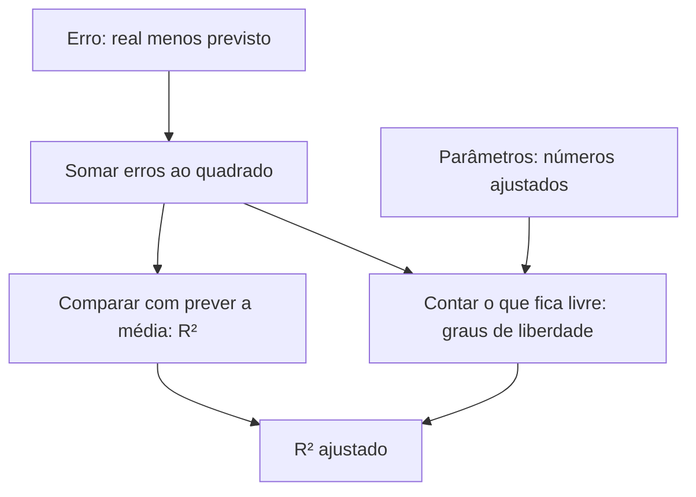

> [!quote] YOU

Quero aprender R² ajustado.

> [!abstract] PI

Vou primeiro verificar o que você já entende de $R^2$, para saber de onde começar a explicação do ajuste.

> [!question] Quiz
> Um modelo de regressão tem $R^2 = 0{,}80$ nos dados usados para ajustá-lo. O que isso significa?
>
> Considere a definição usual de $R^2$, comparando os erros do modelo com os erros de prever sempre a média dos valores observados.
>
> 1. A soma dos erros ao quadrado do modelo é 80% da soma obtida ao prever a média.
> 2. A soma dos erros ao quadrado do modelo é 20% da soma obtida ao prever a média.
> 3. O erro de cada previsão é no máximo 20% do valor observado.
> 4. O modelo acerta exatamente 80% dos valores observados.

> [!question] Quiz — Não sei
> Sua resposta: Não sei
> Resposta certa: 2
>
> Pela definição, $R^2 = 1 - \frac{\text{soma dos erros ao quadrado do modelo}}{\text{soma dos erros ao quadrado ao prever a média}}$. Se $R^2 = 0{,}80$, essa razão é $0{,}20$. É uma comparação dos erros somados, não uma porcentagem de previsões exatas nem um limite para cada erro.

> [!question] Quiz
> Uma observação tem valor real $y = 10$. Um modelo prevê $\hat y = 8$ e outro prevê $\hat y = 9$. Qual deles tem menor erro ao quadrado nessa observação?
>
> 1. O que prevê 8; seu erro ao quadrado é 2.
> 2. O que prevê 9; seu erro ao quadrado é 1.
> 3. Os dois; seus erros ao quadrado são iguais.

> [!question] Quiz — Não sei
> Sua resposta: Não sei
> Resposta certa: 2
>
> O erro é o valor observado menos o previsto: $y - \hat y$. Para a previsão 8, o erro ao quadrado é $(10 - 8)^2 = 4$. Para a previsão 9, é $(10 - 9)^2 = 1$. Portanto, a previsão 9 tem menor erro ao quadrado.

> [!question] Quiz
> Um apartamento foi vendido por R$ 300 mil. Um modelo tinha previsto R$ 280 mil. Qual é a diferença entre o preço real e a previsão?
>
> 1. R$ 20 mil.
> 2. R$ 580 mil.
> 3. R$ 280 mil.

> [!success] Quiz — certo ✓
> Sua resposta: 1. R$ 20 mil.
> Resposta certa: 1
>
> A diferença é o preço real menos o previsto: $300 - 280 = 20$ mil reais. Essa diferença é o erro da previsão.

> [!question] Pergunta
> O que você quer conseguir fazer ao aprender $R^2$ ajustado?
>
> 1. Entender a ideia e de onde vem a fórmula (Recommended)
> 2. Interpretar o resultado e comparar modelos na prática
> 3. Resolver exercícios e calcular o valor

> [!example] Resposta
> 1. Entender a ideia e de onde vem a fórmula (Recommended)

> [!abstract] PI

Você já entende o erro como a diferença entre o valor real e a previsão. Ainda precisamos construir o erro ao quadrado e o próprio $R^2$ antes do ajuste.

Vou verificar também a ideia de parâmetros: ela será necessária para entender de onde vem a fórmula.

> [!question] Quiz
> Para prever o preço de um apartamento usando sua área, escolhemos uma regra: previsão = valor fixo + coeficiente × área. Quantos números precisamos ajustar aos dados para definir essa regra?
>
> 1. Três: o valor fixo, o coeficiente e a área.
> 2. Dois: o valor fixo e o coeficiente.
> 3. Um: apenas o coeficiente.

> [!failure] Quiz — errado ✗
> Sua resposta: 3. Um: apenas o coeficiente.
> Resposta certa: 2
>
> A área é a informação que entra na regra para cada apartamento. Os números escolhidos ao ajustar o modelo são o valor fixo (intercepto) e o coeficiente que multiplica a área. Esses dois números são os parâmetros do modelo.

> [!question] Quiz
> Um modelo prevê o preço como R$ 50 mil mais R$ 4 mil por metro quadrado. Para um apartamento de 30 m², quais números fazem parte da regra do modelo, e não das características desse apartamento?
>
> 1. 50 mil e 30.
> 2. 50 mil e 4 mil.
> 3. 4 mil e 30.

> [!success] Quiz — certo ✓
> Sua resposta: 2. 50 mil e 4 mil.
> Resposta certa: 2
>
> 50 mil é o valor fixo da regra, e 4 mil é o coeficiente por metro quadrado. Os 30 m² são uma característica do apartamento. Assim, o modelo tem dois parâmetros, mesmo usando apenas uma característica: a área.

> [!quote] YOU

f0f/1f1f1a1/0e0ec9c/0000737/dadaccc/cccc676/7676848/5656c6c6/0c0cf1f1/a5a50000/9e9ed6d6/d6d6f2f2/f2f2f0f/1f1f1a1/0e0e737/dada717/9898ccc/cccc676/7676848/5656c6c6/0c0cf1f1/a5a57878/ffff0000/9e9ed6d6/d6d6f2f2/f2f2

> [!question] Pergunta
> Essa sequência foi enviada sem querer ou faz parte de algo que você quer analisar?
>
> 1. Foi sem querer; continuar com a aula de $R^2$ ajustado.
> 2. Quero analisar essa sequência.

> [!example] Resposta
> 1. Foi sem querer; continuar com a aula de $R^2$ ajustado.

> [!abstract] PI

Vamos começar antes do $R^2$: pela forma de medir os erros. Depois vamos entender o que muda quando o modelo tem mais parâmetros e construir a fórmula ajustada a partir disso. Estou preparando o mapa dessa sequência.

O caminho será:

1. **Medir o erro do modelo:** por que elevar os erros ao quadrado e somá-los.
2. **Construir o $R^2$:** comparar o modelo com a regra de prever sempre a média.
3. **Entender o problema:** por que adicionar variáveis pode melhorar o $R^2$ sem ajudar nas previsões de novos dados.
4. **Construir o ajuste:** entender os graus de liberdade — quantos valores ficam livres depois de ajustar os parâmetros — e chegar à fórmula.

Vamos usar um exemplo pequeno de preços de apartamentos, mantendo os mesmos dados ao longo da explicação.

> [!abstract] PI

Este é o mapa da aula. As setas mostram o que precisamos entender antes de chegar ao próximo conceito:

> [!question] Pergunta
> Podemos seguir esse plano, começando por que somamos os erros ao quadrado?
>
> 1. Sim, começar por aí.
> 2. Quero mudar o plano.

> [!example] Resposta
> 1. Sim, começar por aí.

> [!abstract] PI

### 1. Por que elevar os erros ao quadrado?

Queremos comparar modelos usando **um número que resuma os erros de todas as previsões**.

Você já calculou o erro de uma previsão:

$$
\text{erro} = \text{valor real} - \text{valor previsto}.
$$

Vamos usar preços em **milhares de reais**:

| Apartamento | Preço real | Preço previsto | Erro |
|---|---:|---:|---:|
| A | 300 | 280 | $300 - 280 = 20$ |
| B | 300 | 320 | $300 - 320 = -20$ |

O sinal indica o lado do erro:
- $20$: o modelo previu **abaixo** do preço real.
- $-20$: o modelo previu **acima** do preço real.

Se simplesmente somarmos:

$$
20 + (-20) = 0.
$$

**A soma é zero, mas nenhuma das duas previsões acertou.** Os sinais fizeram os erros se cancelar.

Precisamos de uma medida em que errar para cima não apague um erro para baixo. Uma maneira é elevar cada erro ao quadrado. Elevar ao quadrado significa multiplicar o número por ele mesmo:

$$
20^2 = 20 \times 20 = 400,
$$

$$
(-20)^2 = (-20) \times (-20) = 400.
$$

Agora somamos:

$$
400 + 400 = 800.
$$

Essa é a **soma dos erros ao quadrado**. Ela será a medida de erro usada para construir o $R^2$.

O quadrado não é a única escolha possível: usar o valor absoluto também evita o cancelamento. Aqui estamos construindo a medida que entra na definição usual de $R^2$.

> [!question] Quiz
> Um modelo tem erros de $+3$ e $-3$ em duas observações. Qual é a soma dos erros ao quadrado?
>
> 1. $0$.
> 2. $6$.
> 3. $36$.
> 4. $18$.

> [!success] Quiz — certo ✓
> Sua resposta: 4. $18$.
> Resposta certa: 4
>
> Elevamos cada erro ao quadrado antes de somar: $3^2 + (-3)^2 = 9 + 9 = 18$. Somar os erros primeiro daria zero e esconderia os erros. Somar seus tamanhos daria 6, mas isso seria a soma dos valores absolutos, não dos quadrados.

> [!abstract] PI

### 2. Com o que comparar o erro do modelo?

A soma dos erros ao quadrado mede quanto o modelo errou. Mas falta uma referência: **ele errou menos do que uma regra simples, que nem usa as características dos apartamentos?**

Vamos usar três preços, em milhares de reais:

$$
100,\quad 200,\quad 300.
$$

Uma regra simples é prever **o mesmo preço para todos**. Como escolher esse preço?

Vamos comparar duas escolhas:

| Previsão fixa | Erros | Soma dos erros ao quadrado |
|---|---|---:|
| $100$ | $0,\ 100,\ 200$ | $0 + 10\,000 + 40\,000 = 50\,000$ |
| $200$ | $-100,\ 0,\ 100$ | $10\,000 + 0 + 10\,000 = 20\,000$ |

Prever $200$ dá menos erro. Esse valor é a média dos três preços:

$$
\text{média} = \frac{100 + 200 + 300}{3} = 200.
$$

Podemos verificar por que nenhuma outra previsão fixa é melhor neste exemplo. Qualquer escolha pode ser escrita como $200 + d$, em que $d$ é quanto nos afastamos de $200$.

Os três erros ficam $-100-d$, $-d$ e $100-d$. Ao elevar ao quadrado e somar, temos:

$$
(-100-d)^2 + (-d)^2 + (100-d)^2
= 20\,000 + 3d^2.
$$

Como $d^2$ nunca é negativo, afastar a previsão de $200$ só aumenta essa soma. O menor valor ocorre quando $d=0$.

**A média é a melhor previsão fixa quando medimos o erro pela soma dos quadrados.** Esse resultado também vale para outros conjuntos de valores.

Por isso, ela será nossa referência: vamos comparar o modelo com **prever sempre a média**, sem usar área, localização ou qualquer outra característica.

> [!question] Quiz
> Nos três preços $100$, $200$ e $300$, prever sempre a média produz uma soma dos erros ao quadrado de $20\,000$. Um modelo que usa a área dos apartamentos produz $5\,000$ nos mesmos dados. Qual tem menor erro por essa medida?
>
> 1. O modelo que usa a área.
> 2. Os dois têm o mesmo erro.
> 3. A regra que prevê a média.

> [!question] Quiz — Não sei
> Sua resposta: Não sei
> Resposta certa: 1
>
> O modelo tem soma dos erros ao quadrado de $5\,000$, menor que os $20\,000$ da regra que prevê a média. Portanto, ele ajusta melhor esses dados por essa medida. Ainda não estamos avaliando previsões em dados novos.

> [!abstract] PI

Vamos separar a comparação da conta.

**A soma dos erros ao quadrado mede erro, não acerto.** Portanto:
- **Menor** soma significa menos erro nos dados comparados.
- **Maior** soma significa mais erro.

No exemplo, $5\,000 < 20\,000$. Então o modelo que usa a área errou menos do que a regra da média.

O limite dessa medida também ajuda a entender a direção: se todas as previsões fossem exatas, todos os erros seriam zero, e a soma dos quadrados seria **zero**.

> [!question] Quiz
> Dois modelos fazem previsões para os mesmos apartamentos. O modelo A tem soma dos erros ao quadrado igual a $40$; o modelo B, igual a $10$. Qual ajusta melhor esses dados por essa medida?
>
> 1. O modelo B.
> 2. Os dois igualmente.
> 3. O modelo A.

> [!warning] Quiz — cancelado
> (pulado)

> [!abstract] PI

Paramos aqui, antes de construir o $R^2$.
