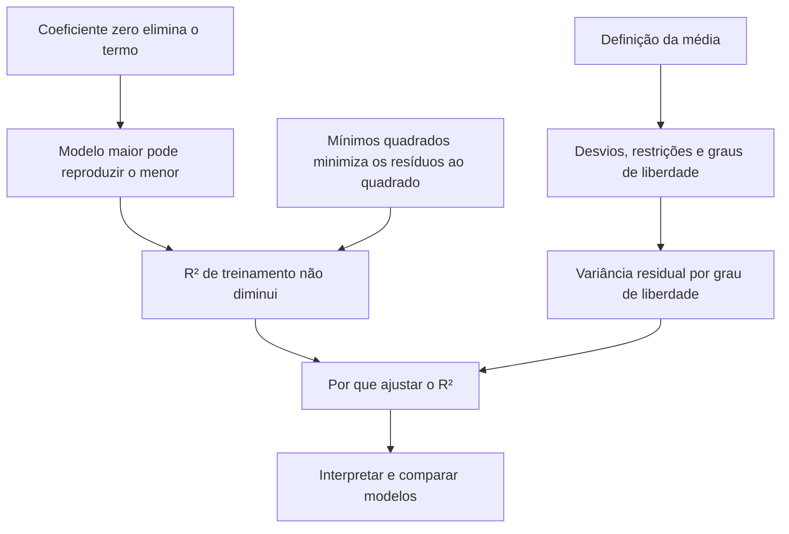

# Resposta A

## Fase 2 — Plano

Você sabe calcular a variação dos dados e entende que a regressão linear escolhe a reta que minimiza a soma dos quadrados dos resíduos. Falta ligar isso a duas perguntas:

1. **Por que acrescentar uma variável não faz o $R^2$ de treinamento cair, mesmo que ela seja ruído?**
2. **Como levar em conta a quantidade de coeficientes estimados ao comparar modelos?**

Vamos trabalhar com **regressões lineares ajustadas por mínimos quadrados, com intercepto e usando as mesmas observações**. Essa delimitação importa: é nesse cenário que vamos demonstrar que acrescentar variáveis não diminui o $R^2$.

O caminho será:

1. **Mostrar que o modelo maior consegue reproduzir o menor.** Basta zerar o coeficiente da variável nova. Esse será o primeiro nó.
2. **Usar a minimização dos resíduos para explicar por que o $R^2$ nunca cai.** Isso corrige a ideia de que uma variável inútil necessariamente piora essa medida.
3. **Construir graus de liberdade a partir da média.** Vamos descobrir por que os desvios em relação à média não podem variar todos independentemente e de onde vem o $n-1$.
4. **Levar esse raciocínio para a regressão.** Estimar coeficientes também reduz os graus de liberdade disponíveis para medir a variação residual.
5. **Construir o $R^2$ ajustado.** A fórmula aparecerá como consequência de comparar duas estimativas de variância, não como uma expressão para decorar.
6. **Interpretar uma saída de regressão.** Vamos entender quando o $R^2$ ajustado aumenta, quando diminui e como usá-lo para comparar modelos — sem confundir melhor ajuste com garantia de melhor previsão em dados novos.

### Mapa de dependências

As raízes são fatos que você já conhece ou pode conferir diretamente: multiplicar por zero elimina um termo, mínimos quadrados escolhe a menor soma dos quadrados dos resíduos, e a média é a soma dos valores dividida pela quantidade deles.

Considerando o plano aprovado, começamos pelo primeiro nó.

---

## Fase 3 — Nó 1: o modelo maior pode reproduzir o menor

### 1. Motivar: o que realmente muda quando acrescentamos uma variável?

Você respondeu que o $R^2$ cai quando acrescentamos uma variável que é puro ruído. No cenário definido acima, ele **não cai**.

Antes de demonstrar isso, precisamos resolver uma questão anterior:

> Ao acrescentar uma variável, o modelo é obrigado a usá-la com algum efeito sobre a previsão?

Se fosse obrigado, a variável nova poderia impedir o modelo de fazer algo que ele fazia antes. Mas vamos verificar isso na própria equação.

### 2. Estabelecer: um coeficiente zero elimina a contribuição da variável

Considere primeiro um modelo com uma variável explicativa:

$$
\hat y = b_0 + b_1x.
$$

Aqui:

- $\hat y$ é a previsão do modelo;
- $x$ é a variável explicativa;
- $b_0$ é o intercepto: a previsão quando $x=0$;
- $b_1$ é o coeficiente de $x$: quanto a previsão muda quando $x$ aumenta uma unidade.

Agora acrescentamos uma variável $z$:

$$
\hat y = b_0 + b_1x + b_2z.
$$

O novo coeficiente, $b_2$, determina a contribuição de $z$ para a previsão.

A verdade básica de que precisamos é:

$$
0\cdot z = 0.
$$

Portanto, **escolher $b_2=0$ elimina o termo novo**, qualquer que seja o valor de $z$.

Vamos conferir com números. Suponha que o modelo antigo tenha sido ajustado e produzido:

$$
\hat y = 2 + 3x.
$$

No modelo maior, podemos escolher os coeficientes:

$$
b_0=2,\qquad b_1=3,\qquad b_2=0.
$$

Com essa escolha:

$$
\hat y = 2 + 3x + 0z = 2 + 3x.
$$

Para uma observação com $x=4$ e $z=100$, o modelo antigo prevê:

$$
\hat y = 2 + 3\cdot4 = 14.
$$

O modelo maior, com aqueles coeficientes, prevê:

$$
\hat y = 2 + 3\cdot4 + 0\cdot100 = 14.
$$

O valor de $z$ poderia ser outro. A contribuição continuaria sendo zero.

Isso não vale apenas para esse exemplo numérico. **Qualquer escolha de coeficientes do modelo antigo pode ser reproduzida no modelo maior:** conservamos os coeficientes antigos e zeramos o novo.

### 3. Conectar: o que isso implica para o ajuste?

Você já sabe que ajustar uma regressão por mínimos quadrados significa procurar os coeficientes que deixam a soma dos quadrados dos resíduos tão pequena quanto possível.

O que acabamos de estabelecer diz algo sobre as opções disponíveis nessa procura:

- Antes, podíamos escolher $b_0$ e $b_1$.
- Agora, podemos escolher $b_0$, $b_1$ e $b_2$.
- Entre as escolhas do modelo maior estão **todas as escolhas do modelo antigo**, usando $b_2=0$.

Logo, acrescentar $z$ **não retira nenhuma possibilidade anterior de previsão**. Apenas permite outras possibilidades.

É importante separar duas afirmações:

- **O modelo maior pode reproduzir o menor.** Acabamos de demonstrar isso.
- **O ajuste vai escolher $b_2=0$.** Isso ainda não sabemos; ele pode escolher outro valor.

Mesmo que $z$ seja ruído, zerar seu coeficiente continua sendo uma opção disponível. No próximo nó, usaremos essa opção e a regra de minimização para demonstrar o que acontece com os resíduos e com o $R^2$.

### Checagem do nó

Um modelo usa $x$ para prever $y$. Um segundo modelo acrescenta $z$, mantendo o intercepto e $x$, sem impor restrições aos coeficientes.

**Quais previsões do modelo antigo o modelo maior consegue reproduzir por alguma escolha de seus coeficientes?**

a) Consegue reproduzir todas as previsões do modelo antigo.

b) Consegue reproduzir apenas as previsões do modelo antigo nas observações em que $z=0$.

c) Consegue reproduzir apenas as previsões do modelo antigo se $z$ tiver relação com $y$.
