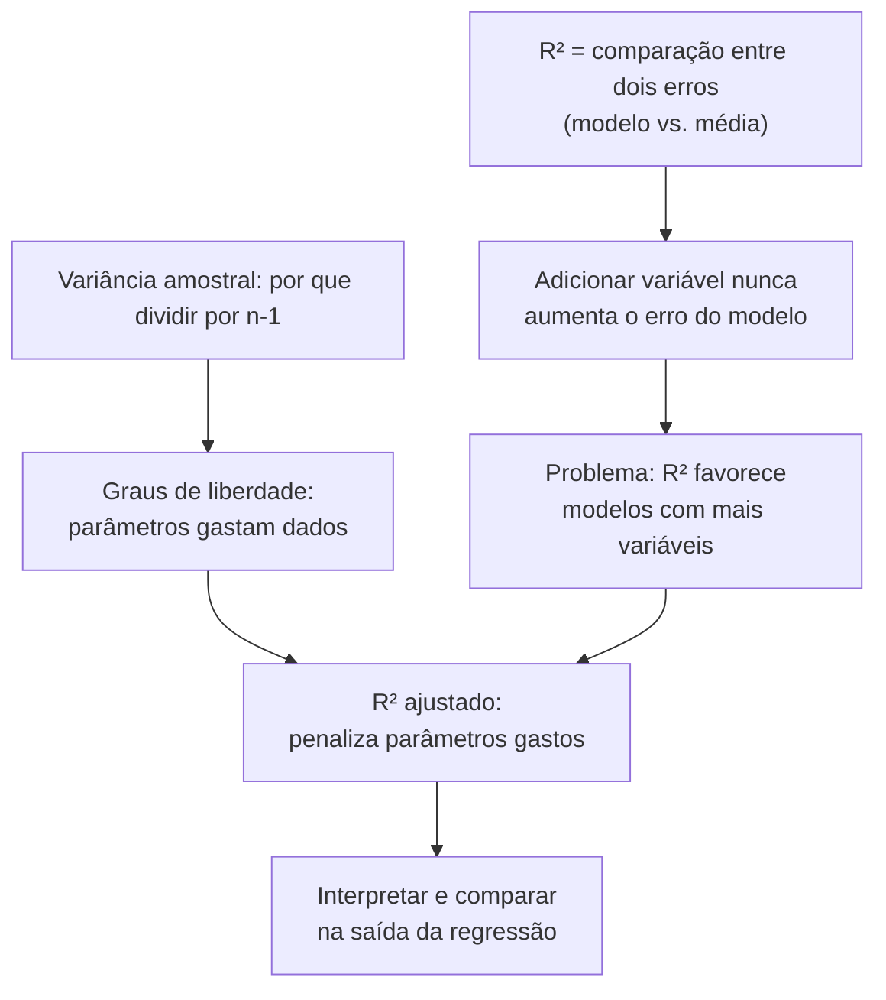

# Resposta B

# Fase 2 — Plano

**O que você já tem e onde termina:** você domina média, variância, soma dos quadrados, resíduos e o R² como frase. O que falta são dois pontos exatos: (1) por que adicionar variável — mesmo ruído puro — **nunca** faz o R² cair, e (2) o que são graus de liberdade, que você nunca viu (não sabe nem por que a variância amostral divide por $n-1$).

**A rota:** primeiro consertamos o buraco do R² — mostrar que o R² é uma comparação entre dois erros (modelo vs. média) e que adicionar variável só dá ao modelo mais opções, nunca menos. Isso motiva a pergunta central: *como comparar dois modelos que gastam quantidades diferentes de parâmetros?* Aí entra o nó de graus de liberdade, construído a partir da variância que você já sabe calcular à mão (o porquê do $n-1$). Com os dois nós em mãos, o R² ajustado não aparece como uma fórmula decorada: é a resposta óbvia à pergunta "e se eu penalizar cada parâmetro gasto?". Por fim, a interpretação prática: como ler e comparar os valores numa saída de regressão.

O nó C (R² como comparação de erros) você já tem em forma de frase; vamos torná-lo operacional primeiro, pois tudo depende dele.

---

# Fase 3 — Nó 1: R² é uma comparação entre dois erros

**Motivar.** Você errou a pergunta "o que acontece com o R² quando você adiciona uma variável que é puro ruído?". Respondeu que cai. Ele nunca cai. Para ver por quê, não basta repetir a frase "fração da variância explicada" — precisamos do R² escrito de um jeito que mostre sua mecânica: dois erros lado a lado.

**Estabelecer.** Comece pelo que você já sabe: a reta de regressão minimiza a soma dos quadrados dos resíduos. Chame a soma desses resíduos ao quadrado de $SS_{\text{res}}$ (soma dos quadrados dos **res**íduos):

$$SS_{\text{res}} = \sum_i (y_i - \hat{y}_i)^2$$

Cada termo: $y_i$ é o valor observado, $\hat{y}_i$ é a previsão do modelo, e a soma percorre os $n$ pontos. É o erro do **modelo**.

Agora o segundo erro. Pergunte-se: qual é o pior "modelo" razoável possível? O que você preveria se tivesse **zero** variáveis explicativas — só a lista de valores $y$? A melhor previsão possível nesse caso é a média $\bar{y}$ (é exatamente por isso que minimizar soma de quadrados com zero variáveis dá a média). O erro desse "modelo da média" é:

$$SS_{\text{tot}} = \sum_i (y_i - \bar{y})^2$$

É a soma dos quadrados dos desvios em torno da média — o material bruto da variância que você já calculou à mão.

O R² é a fração que você ganha ao passar do modelo burro (média) para o seu modelo:

$$R^2 = 1 - \frac{SS_{\text{res}}}{SS_{\text{tot}}} = \frac{SS_{\text{tot}} - SS_{\text{res}}}{SS_{\text{tot}}}$$

Leia com calma: se o modelo é perfeito, $SS_{\text{res}} = 0$ e $R^2 = 1$. Se o modelo não é melhor que a média, $SS_{\text{res}} = SS_{\text{tot}}$ e $R^2 = 0$. $SS_{\text{tot}}$ é fixo para um dataset (depende só dos valores $y$); o que muda de modelo para modelo é $SS_{\text{res}}$.

**Conectar.** Agora o seu erro, com essa forma: adicionar uma variável ao modelo significa dar ao ajuste **mais liberdade** — a reta vira um plano/plano hiperplano com um parâmetro a mais para escolher. O método de ajuste escolhe os parâmetros que minimizam $SS_{\text{res}}$. Com um parâmetro extra, o espaço de escolhas **contém** tudo que era possível antes (basta fixar o novo coeficiente em zero). O mínimo sobre um conjunto maior é menor ou igual ao mínimo sobre um conjunto menor. Logo $SS_{\text{res}}$ nunca aumenta, e $R^2 = 1 - SS_{\text{res}}/SS_{\text{tot}}$ nunca cai. Nem com ruído puro: no pior caso o modelo "ignora" a variável (coeficiente zero) e o R² fica igual; na prática o ruído sempre tem alguma correlação de amostra por acaso, e o R² sobe um pouco, sem significado nenhum por trás. É exatamente esse defeito que motiva o próximo nó: um critério que só sobe não serve para escolher entre modelos.

---

**Checagem do nó 1:**

Adicionamos ao modelo uma variável explicativa que é puro ruído (sem relação nenhuma com $y$). O que acontece com $SS_{\text{res}}$ do modelo ajustado, comparado ao do modelo anterior?

a) Sempre diminui um pouco, porque ruído sempre contém alguma informação útil.
b) Diminui ou fica igual — nunca aumenta — pois o ajuste pode sempre ignorar a nova variável.
c) Aumenta, pois o ruído "sujá" o modelo com variável sem relação com $y$.
d) Fica exatamente igual, pois o ajustamento percebe que a variável é ruído e zera seu coeficiente.

*(Responda antes de seguirmos para o nó de graus de liberdade.)*
