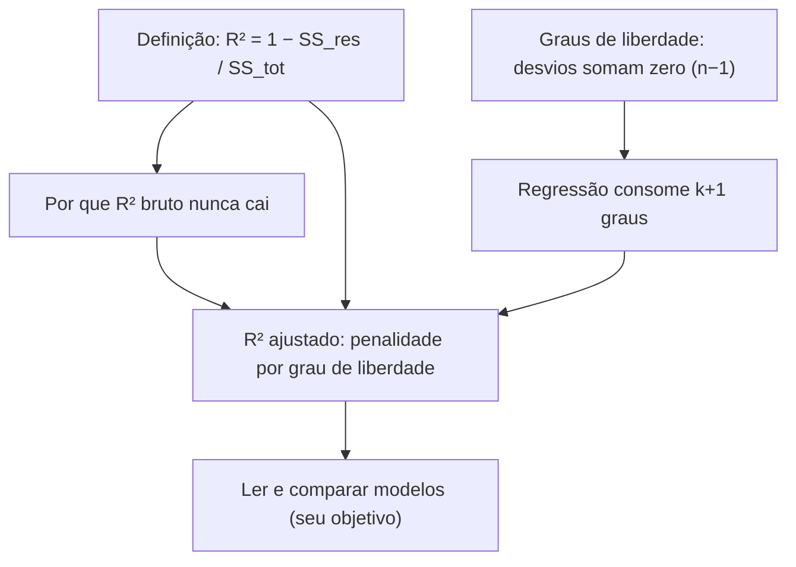

# Resposta A

## Fase 2 — Plano

A sua sondagem me deu um mapa muito bom — e revelou uma coisa bonita: **no lugar onde você errou, a sua intuição estava certa.** Você disse que o R² deveria cair quando entra uma variável que é puro ruído. Essa é exatamente a intuição que motiva o R² ajustado a existir. O problema não é o seu raciocínio — é que o **R² bruto trai essa intuição**: ele nunca cai. Então o plano não é "te ensinar um truque novo"; é **vindicar a sua intuição**, mostrando passo a passo o que falta para ela valer na prática.

O caminho, construído a partir exatamente do que você já domina (média, variância, soma dos quadrados, minimização dos resíduos) e do que ficou em aberto (por que o R² nunca cai, e o que são graus de liberdade):

1. **Fixar a forma computacional do R²** — destilar a frase "fração da variância explicada" na fórmula $R^2 = 1 - \frac{SS_{res}}{SS_{tot}}$. É o chão sobre o qual o ajustado será construído.
2. **Provar por que o R² bruto nunca cai** — e mostrar que isso é uma falha *dele*, não da sua intuição. A prova nasce direto da definição do nó 1.
3. **Construir graus de liberdade do zero** — a partir de uma identidade algébrica que você mesmo pode verificar ("os desvios em torno da média somam zero"). É a peça que faltava, e ninguém tinha te dado ela de um jeito que caísse no lugar.
4. **Generalizar para a regressão** — um modelo com $k$ variáveis explicativas "consome" graus de liberdade, e é isso que o R² bruto ignora.
5. **Montar o R² ajustado** — a mesma fórmula do bruto, mas com o "custo" de cada variável extra embutido. Aqui sua intuição é restaurada.
6. **Chegar ao seu objetivo** — ler um R² ajustado numa saída de regressão e comparar modelos com números diferentes de variáveis.

O mapa de dependências — cada nó pende do que sustenta ele; as raízes são as verdades incondicionais que já dá para aceitar de cara:

Cada nó vai passar pelo mesmo tratamento: motivar (por que ele é necessário agora), estabelecer (como você poderia ter descoberto isso), conectar (em qual nó anterior ele se pendura) e checar (uma pergunta para confirmar que caiu). Duas raízes, dois chãos: a **definição computacional do R²** (você já tem a frase, vamos só traduzi-la em fórmula) e **graus de liberdade** (que você marcou "não sei" — vamos construí-la do zero, sem mágica).

---

## Começando — Nó 1 (raiz): a forma computacional do R²

### Motivar

Por que começar aqui, e não direto no "ajustado"? Porque o R² ajustado **não é uma fórmula nova**: ele é literalmente o R² bruto com uma peça trocada no lugar certo. Se a gente não fixar primeiro a fórmula do bruto, o ajustado vai parecer uma sopa de letras — e aí você termina decorando em vez de entender. Então este nó é para destilar a frase que você já domina ("fração da variância explicada") numa equação concreta. Poucos passos — mas é o piso da casa toda.

### Estabelecer

Você já calculou variância à mão, então já encostou em uma peça: o **espalhamento total** dos dados em torno da média. Dê a ele um nome:

$$
SS_{tot} = \sum (y_i - \bar{y})^2
$$

É a Soma **Total** dos Quadrados. (É exatamente o numerador da variância — a variância é $SS_{tot}/n$.)

Agora a pergunta que transforma a frase em fórmula: **o que sobrou depois de ajustar o modelo?** Sobrou exatamente o que a reta tenta deixar o menor possível — os resíduos. O espalhamento que sobrou é:

$$
SS_{res} = \sum (y_i - \hat{y}_i)^2
$$

A Soma dos Quadrados dos **Resíduos**.

Aqui está o pulo do gato — e você poderia ter chegado nele sozinho. A frase diz "fração da variância **explicada**". Mas o que o modelo *explica* é o total **menos** o que sobrou. Se o total é $SS_{tot}$ e sobrou $SS_{res}$, então o que foi explicado é $SS_{tot} - SS_{res}$. A **fração** explicada é isso dividido pelo total:

$$
R^2 = \frac{SS_{tot} - SS_{res}}{SS_{tot}} = 1 - \frac{SS_{res}}{SS_{tot}}
$$

Repare no quê: para saber o quanto o modelo *explicou*, é mais fácil olhar quanto *sobrou* e subtrair de 1. Foi o mesmo movimento de "se eu sei quanto sobrou, sei quanto tirei" — nada apareceu do nada.

### Conectar

Esta fórmula não é informação nova — é a **tradução da sua frase para números**, pendurada em duas coisas que você já tem: a variância (que te dá $SS_{tot}$) e a ideia de que a reta minimiza os resíduos (que te dá $SS_{res}$). E ela explica por coerência os dois casos que você já acertou na sondagem: se o ajuste é perfeito, $SS_{res} = 0$ e $R^2 = 1$; se o modelo não explica nada, $SS_{res} = SS_{tot}$ e $R^2 = 0$.

Ela também já reformula a pergunta que você errou: "por que o R² nunca cai ao adicionar variável?" agora vira **"por que $SS_{res}$ nunca aumenta ao adicionar variável?"** — porque, pela fórmula, se $SS_{res}$ nunca aumenta, $R^2$ nunca diminui. É exatamente isso que o nó 2 vai responder. Mas primeiro, a checagem:

### Checagem

Com $SS_{tot}$ sendo o espalhamento total e $SS_{res}$ o espalhamento que sobra depois do ajuste, qual é a definição computacional do $R^2$?

a) $R^2 = \frac{SS_{res}}{SS_{tot}}$

b) $R^2 = 1 - \frac{SS_{res}}{SS_{tot}}$

c) $R^2 = \frac{SS_{tot}}{SS_{res}}$

d) $R^2 = 1 - \frac{SS_{tot}}{SS_{res}}$
