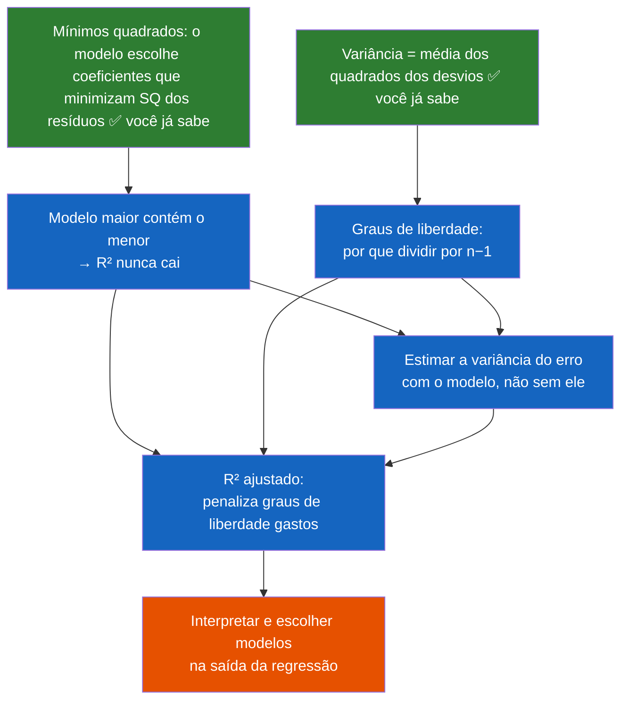

# Resposta B

# Fase 2 — O plano

## A abordagem, em prosa

Breno, sua sondagem revelou algo interessante: seu erro não foi aleatório. Você respondeu que o R² *cai* ao adicionar ruído porque você está segurando um modelo mental em que o R² "premia honestidade" — mas o R² é uma fração, calculada de uma conta mecânica, e não tem opinião sobre honestidade. O caminho até o R² ajustado passa exatamente por desmontar essa intuição errada e substituí-la por algo mais sólido.

A boa notícia: você já tem quase tudo o que precisamos. Você sabe que a reta minimiza a soma dos quadrados dos resíduos, e sabe variância. O que falta são dois nós novos:

1. **Por que o R² nunca cai** (não é uma propriedade mágica do R² — é uma consequência direta de algo que você já sabe sobre mínimos quadrados, e vou te mostrar como poderia ter descoberto sozinho).
2. **Graus de liberdade** — o motivo pelo qual a variância amostral divide por $n-1$. Isso não é um detalhe técnico: é a peça que faltava na sua sondagem, e sem ela o R² ajustado é só uma fórmula decorada.

Depois disso, o R² ajustado deixa de ser uma fórmula arbitrária: ele vira a resposta *natural* a uma pergunta que você mesmo vai formular ("como eu comparo dois modelos que gastam quantidades diferentes de graus de liberdade?"). No fim, você interpreta uma saída de regressão real e escolhe entre modelos com números diferentes de variáveis.

## O mapa de dependências

Os dois nós na base em verde são coisas que você **já demonstrou dominar** na sondagem — são o chão em que vamos construir.

---

Plano aprovado. Vamos ao primeiro nó.

# Fase 3 — Nó 1: por que o R² nunca cai

## Motivar

Vamos começar pelo seu próprio erro, porque ele é o ponto de partida perfeito. Você respondeu que adicionar uma variável de puro ruído *faz o R² cair* — e eu quero que você sinta o peso do motivo pelo qual essa resposta é impossível.

Pense no que acontece na prática: você ajusta um modelo com 3 variáveis, obtém um R². Depois ajusta com as mesmas 3 variáveis **mais** uma variável de ruído. O segundo modelo tem mais opções que o primeiro. A pergunta motivadora é:

> *Quando um otimizador tem mais opções disponíveis, ele pode acabar pior do que quando tinha menos?*

Guarde essa pergunta. Ela é o coração de tudo.

## Estabelecer

Aqui está o fato central, e ele é incondicional:

> **Um modelo com mais variáveis contém, dentro do espaço de escolhas dele, todos os modelos com menos variáveis.**

O que isso significa, concretamente: quando você ajusta a regressão com 4 variáveis, o método de mínimos quadrados procura a melhor combinação linear $y = \beta_0 + \beta_1 x_1 + \beta_2 x_2 + \beta_3 x_3 + \beta_4 x_4$. Entre as infinitas combinações que ele pode escolher, existe uma muito especial: aquela com $\beta_4 = 0$. E essa combinação é *exatamente* o modelo de 3 variáveis que você ajustou antes.

Então a lógica fechada é:

1. O modelo de 4 variáveis pode escolher $\beta_4 = 0$, o que reproduz fielmente o modelo de 3 variáveis — mesmo erro, mesma soma dos quadrados dos resíduos.
2. Mínimos quadrados, pela sua definição, escolhe a combinação que **minimiza** a soma dos quadrados dos resíduos — nunca uma pior.
3. Logo, o modelo de 4 variáveis tem soma de quadrados dos resíduos **menor ou igual** à do modelo de 3 variáveis. Nunca maior.

A variável de ruído, no pior caso, é completamente ignorada ($\beta_4 = 0$ e o R² fica igual). No caso real, mínimos quadrados sempre encontra *alguma* correlação espúria com o ruído — mesmo que não exista relação real — e usa isso para reduzir os resíduos um pouquinho. É por isso que o R² sobe **sempre**, até com ruído puro. Não é um defeito do R²; é consequência inevitável de ele medir apenas "quanto o erro encolheu" sem perguntar *a que preço*.

E é exatamente esse "a que preço" que vai motivar o R² ajustado mais adiante — a penalidade existe para cobrar esse preço.

## Conectar

Observe como este nó não é um fato novo solto: ele deriva **inteiramente** do que você já sabia (mínimos quadrados minimiza resíduos). A única peça nova foi perceber que "modelo maior" = "conjunto de escolhas que inclui as do modelo menor". Isso é o que corrige sua intuição: o R² não é um juiz que recompensa simplicidade — é uma fita métrica que só sabe medir o tamanho do erro, e erro maior de opções nunca gera erro maior de resultado.

E já que a fita métrica está viciada a favor de modelos maiores, fica a pergunta que abre o próximo nó: **o que deveríamos medir no lugar?** A resposta passa pelos graus de liberdade — o tema do nó 2.

## Checagem do nó

**Pergunta:** Você ajusta um modelo com 5 variáveis e obtém $R^2 = 0{,}73$. Depois ajusta um novo modelo: as **mesmas** 5 variáveis, mais uma sexta variável que é gerada de números totalmente aleatórios (puro ruído, sem relação com $y$). O que pode acontecer com o R² do novo modelo?

a) Pode subir ou ficar igual, mas nunca cai abaixo de $0{,}73$ — porque o novo modelo pode sempre reproduzir o antigo zerando o coeficiente da sexta variável.

b) Pode subir ou cair — depende se a variável de ruído distorce os coeficientes das outras variáveis no ajuste.

c) Vai cair com alta probabilidade, porque a variável de ruído reduzir a precisão média das estimativas dos coeficientes.

d) Fica exatamente igual a $0{,}73$, pois uma variável sem correlação com $y$ recebe coeficiente zero no ajuste.
