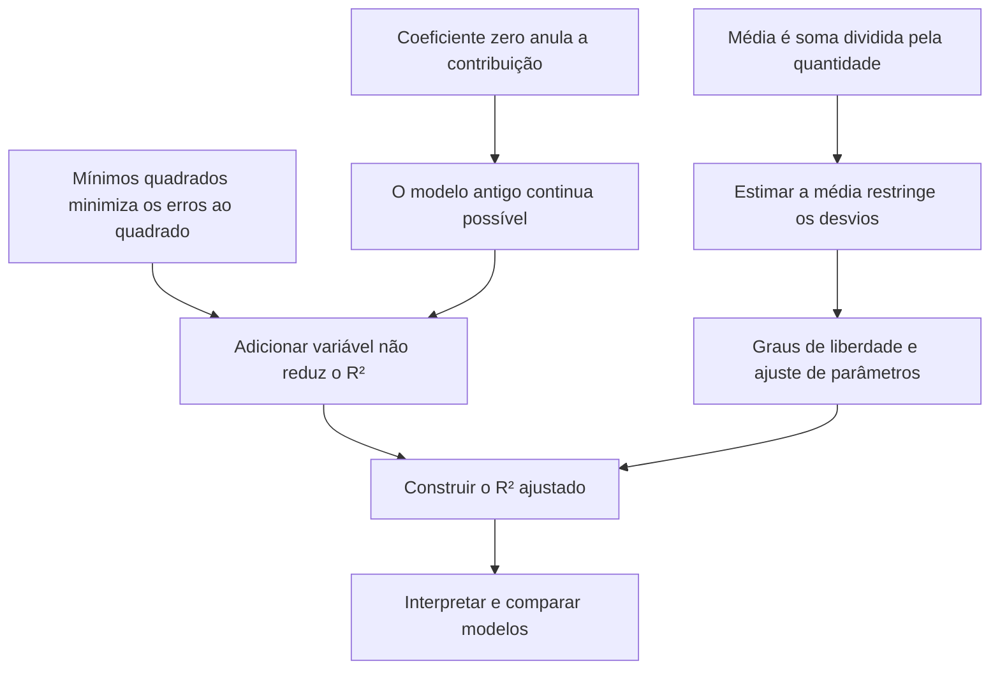

# Resposta C

## Fase 2 — Plano

Breno, vamos partir do que você já domina: **a regressão linear procura minimizar a soma dos quadrados dos resíduos**. A primeira lacuna é entender por que adicionar uma variável não pode piorar esse mínimo — mesmo que a variável seja ruído. Vamos chegar a isso sem precisar começar pela fórmula do $R^2$ ajustado.

Depois, vamos construir a ideia de **graus de liberdade** a partir da média: como estimar algo usando os próprios dados cria uma restrição sobre os desvios. Isso vai dar sentido às divisões por $n-1$ e $n-p-1$, em vez de tratá-las como regras para decorar.

Por fim, juntaremos os dois caminhos para descobrir a fórmula do $R^2$ ajustado e interpretar sua subida ou queda ao comparar modelos. Também delimitaremos o que ele permite concluir: **melhor $R^2$ ajustado não garante melhor previsão em dados novos**.

Para essa construção, vamos considerar regressões lineares ajustadas por mínimos quadrados, **com intercepto e sobre as mesmas observações**. Aqui, $n$ será o número de observações e $p$ o número de variáveis explicativas, sem contar o intercepto.

### Mapa de dependências

Considerando o plano aprovado, vamos começar pelo primeiro nó.

---

## Fase 3 — Nó 1: coeficiente zero anula a contribuição

### 1. Motivar: por que precisamos disso?

Sua resposta anterior foi que acrescentar uma variável de puro ruído faria o $R^2$ cair.

Existe uma intuição compreensível aí: “se eu acrescento informação inútil, posso atrapalhar o modelo”.

Para investigar essa ideia, precisamos separar duas coisas:

- **Permitir** que o modelo use uma variável nova.
- **Obrigar** o modelo a usar essa variável com alguma influência na previsão.

Será que acrescentar uma variável à equação obriga o modelo a lhe dar influência?

### 2. Estabelecer: como uma variável influencia a previsão?

Considere um modelo linear com uma variável:

$$
\hat y = b_0 + b_1x.
$$

Aqui, $\hat y$ é a previsão, $b_0$ é o intercepto e $b_1$ é o coeficiente de $x$.

Ao acrescentar uma variável $z$, passamos a permitir previsões da forma:

$$
\hat y = b_0 + b_1x + b_2z.
$$

Repare no mecanismo: **a contribuição de $z$ para a previsão é o produto $b_2z$**.

A verdade básica que precisamos fixar é:

$$
0\cdot z = 0
$$

para qualquer valor real de $z$.

Portanto, se escolhermos $b_2=0$, a variável nova não contribui para a previsão:

$$
\hat y
= b_0 + b_1x + 0\cdot z
= b_0 + b_1x.
$$

Isso não depende de $z$ ser útil, inútil, grande, pequena ou puro ruído. **Coeficiente zero significa contribuição zero.**

### 3. Conectar: o que isso nos permite enxergar?

Imagine que o modelo antigo faça a previsão:

$$
\hat y = 10 + 2x.
$$

O modelo ampliado permite equações da forma:

$$
\hat y = b_0 + b_1x + b_2z.
$$

Uma escolha permitida é:

$$
b_0=10,\qquad b_1=2,\qquad b_2=0.
$$

Com essa escolha, o modelo ampliado reproduz exatamente o antigo.

Esse é o vínculo que estamos começando a construir:

> **Adicionar uma variável abre uma possibilidade de usá-la; não obriga a dar influência a ela.**

Ainda não afirmamos qual coeficiente o ajuste vai escolher. Apenas identificamos uma escolha que continua disponível. No próximo nó, essa possibilidade será conectada à minimização dos erros.

### Checagem do nó

Um modelo antigo prevê:

$$
\hat y = 4 + 3x.
$$

Você acrescenta uma variável $z$, passando a usar:

$$
\hat y = 4 + 3x + cz.
$$

Qual escolha de $c$ garante que as previsões continuem exatamente iguais às do modelo antigo, para quaisquer valores reais de $x$ e $z$?

a) $c=1$  
b) $c=0$  
c) $c=-1$
